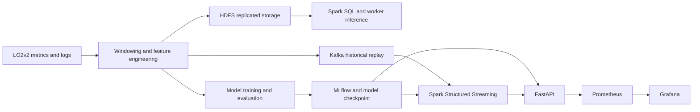

# CloudPulse AI

CloudPulse AI is an academic AIOps platform that detects unusual microservice
behavior in LO2v2 telemetry, investigates service-level deviations, and
delivers simulated alerts through Kafka, Spark, and Grafana. The repository
includes eight executed notebooks, reproducible Python pipelines, and a
Docker lab for testing HDFS replication and Spark on two workers.

## What the project demonstrates

- **Observability and ML** — Align seven Light-OAuth2 services by timestamp,
  build overlapping 20-second windows, and split by collection run before
  fitting preprocessing statistics. Compare statistical and supervised
  baselines, five PyTorch models, and an exploratory logs/metrics fusion.
- **Distributed storage and compute** — Store the CSV sample on HDFS with
  two replicas per block. Use Spark SQL for feature construction and Python
  workers for PyTorch inference. Verify output parity against Pandas and
  single-process PyTorch.
- **Streaming and recovery** — Replay historical feature windows through
  Kafka, resume Spark Structured Streaming from a checkpoint, and suppress
  duplicate writes in the prediction sink.
- **Model serving and monitoring** — Track and version an evaluated
  checkpoint in MLflow. Serve predictions through FastAPI and expose
  metrics to Prometheus and Grafana.



## Verified results

| Experiment | Result |
| --- | --- |
| Metrics sample | 387,219 observations, 10 collection runs, 7 services |
| Normalized dataset | 4,207 windows with 98 features per window |
| Held-out API error detection | Random Forest ROC AUC **0.801**; dense autoencoder **0.708** |
| HDFS and Spark lab | 70 input blocks, two replicas each, two inference workers, and 834 predictions verified |
| HDFS-backed preprocessing, 10 runs | **22.72 s** in Spark local mode and **16.53 s** with two workers |
| HDFS-backed preprocessing, 2 runs | **15.47 s** in Spark local mode and **21.02 s** with two workers |
| Kafka restart test | 272 events published, 256 unique predictions, 16 duplicates ignored, 53 simulated alerts |
| Continuous simulated replay | Median publish-to-sink latency of **9.85 s** at 1.99 windows/s and **9.26 s** at 9.80 windows/s |

The test split contains two collection runs and only 11 normal windows.
LO2v2 labels indicate client API error scenarios. Service rankings are
statistical leads for investigation. Confirming causal services or evaluating
infrastructure faults requires additional annotations. The two Spark workers
and HDFS DataNodes ran in containers on one physical host. Timings apply
to this lab and workload.

## Reproduce the CPU experiments

Run these commands in PowerShell from the CloudPulse-AI directory:

```powershell
py -3.11 -m venv .venv
.\.venv\Scripts\python.exe -m pip install -r requirements.txt
.\.venv\Scripts\python.exe -m ipykernel install --user --name cloudpulse-ai --display-name "Python (CloudPulse AI)"

.\.venv\Scripts\python.exe -m src.download
.\.venv\Scripts\python.exe -m src.evaluate --workers 2
.\.venv\Scripts\python.exe -m src.preprocess
.\.venv\Scripts\python.exe -m src.ml_baseline
.\.venv\Scripts\python.exe -m pip install torch==2.15.0+cpu --index-url https://download.pytorch.org/whl/cpu
.\.venv\Scripts\python.exe -m src.deep_learning
.\.venv\Scripts\python.exe -m src.temporal_models
```

The downloader retrieves selected CSVs from the official metrics ZIP over
HTTPS. Data caches, checkpoints, and generated results are excluded from
Git. Regenerate them locally to rerun the notebooks or start the services.
The dataset is provided by the LO2v2 authors under CC BY 4.0.
[LO2v2 on Zenodo](https://zenodo.org/records/18937117) · [Dataset descriptor](https://doi.org/10.1109/IEEEDATA.2026.3701668)

## Notebooks and demo

| Topic | Notebook |
| --- | --- |
| Data quality and class balance | [01 · Data exploration](notebooks/01_data_exploration.ipynb) |
| Aligned sliding windows and run splits | [02 · Preprocessing](notebooks/02_data_preprocessing.ipynb) |
| Error detection and HTTP/scenario classification | [03 · ML baselines](notebooks/03_ml_baseline.ipynb) |
| Dense, recurrent, convolutional and attention models | [04 · Deep learning](notebooks/04_deep_learning.ipynb) |
| Log templates, Transformer and multimodal fusion | [05 · Log intelligence](notebooks/05_log_intelligence.ipynb) |
| Service rankings and lagged associations | [06 · Root cause investigation](notebooks/06_root_cause_analysis.ipynb) |
| Spark SQL and worker inference | [07 · Spark integration](notebooks/07_spark_integration.ipynb) |
| Pandas, Spark, caching and HDFS benchmarks | [08 · Performance benchmark](notebooks/08_performance_benchmark.ipynb) |

Follow the [Spark and HDFS lab guide](docs/spark-hdfs.md) for the distributed
pipeline, the [streaming guide](docs/streaming.md) for Kafka replay and
recovery, and the [monitoring guide](docs/monitoring.md) for MLflow, the API,
and Grafana. After generating the checkpoint and replay artifacts,
`docker compose up --build` starts the monitoring services. The Swagger UI
is available at `http://localhost:8000/docs` and the Grafana dashboard at
`http://localhost:3000/d/cloudpulse-local`.

[Dataset audit](reports/dataset-exploration.md) · [Initial metrics benchmark](reports/metrics-benchmark.md) · [Project status](PROJECT_STATUS.md)
